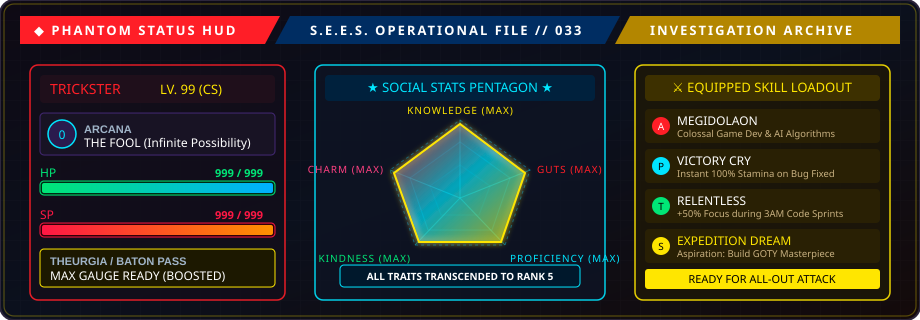
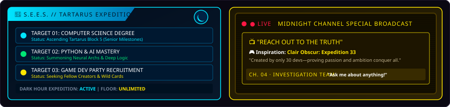
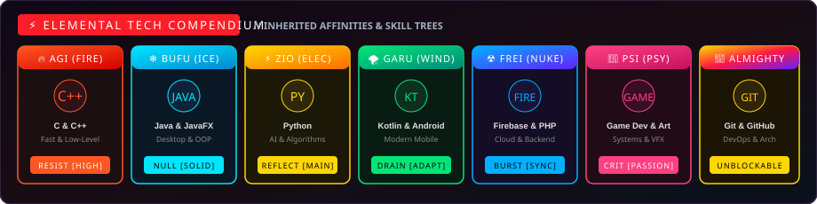

<!-- =====================================================================
     ⚔️ THE TRICKSTER'S COMPENDIUM — PERSONA TRILOGY GITHUB PROFILE ⚔️
     Jairus Espina (@Tech-Wrightttt)
     Themes: Persona 5 Royal · Persona 3 Reload · Persona 4 Golden
     ===================================================================== -->

<!-- ╔══════════════════════════════════════════════════════════════════╗
     ║        1. HERO BANNER: THE PERSONA TRILOGY CONVERGENCE          ║
     ╚══════════════════════════════════════════════════════════════════╝ -->

 

<!-- Persona 5 Calling Card Dynamic Typing Text -->

 

<!-- Phantom Thief Arcana Badge Row -->

  
  
  
  

---

<!-- ╔══════════════════════════════════════════════════════════════════╗
     ║        2. PERSONA STATUS HUD: VITALS & SOCIAL STATS             ║
     ╚══════════════════════════════════════════════════════════════════╝ -->

### 🎭 CHARACTER STATUS // WILD CARD OPERATIONAL HUD

 

<!-- Quick Bio Table / Dossier -->

| 📜 **Dossier Entry** | 🔍 **Investigative Intel** |
|:---|:---|
| 👤 **True Identity** | **Jairus Espina** (Wild Card Bearer) |
| 🎓 **Academic Quest** | Pursuing **Computer Science Degree** 📚 |
| 🎮 **Dream Project** | Crafting immersive worlds & mechanics (Inspired by *Clair Obscur: Expedition 33* — made by 30 devs!) |
| 🧠 **Core Research** | **Artificial Intelligence**, System Architecture & High-Performance Code |
| ⚡ **Current SP Focus** | Deepening **Python Mastery**, **C++ Game Logic**, and **Creative Algorithms** |
| 💬 **Open Dialogue** | *"Ask me about anything!"* — Always down to talk tech, games, and code |

---

<!-- ╔══════════════════════════════════════════════════════════════════╗
     ║        3. P3R & P4G: DARK HOUR & MIDNIGHT CHANNEL LOGS           ║
     ╚══════════════════════════════════════════════════════════════════╝ -->

### 🌙 THE DARK HOUR & 📺 THE MIDNIGHT CHANNEL

---

<!-- ╔══════════════════════════════════════════════════════════════════╗
     ║        4. TECH COMPENDIUM: ELEMENTAL AFFINITIES                 ║
     ╚══════════════════════════════════════════════════════════════════╝ -->

## ⚡ Skill Compendium · Elemental Tech Affinities

> *"I am thou, thou art I... Thou hast turned a vow into a bloodstained blade."*

 

### 🛠️ Summoned Tools & Software Arsenal

  
  
  
  
  
  
  

  
  
  
  
  
  

---

<!-- ╔══════════════════════════════════════════════════════════════════╗
     ║        5. ALL-OUT ATTACK FINISH: GITHUB ANALYTICS & STATS       ║
     ╚══════════════════════════════════════════════════════════════════╝ -->

  

### 📊 METAVERSE INFILTRATION RECORDS // GITHUB ANALYTICS

<!-- Stats & Top Languages side-by-side -->

  
  

<!-- Streak Stats -->

  

---

<!-- ╔══════════════════════════════════════════════════════════════════╗
     ║        6. S.E.E.S. TROPHY WALL & ARCANA ACHIEVEMENTS            ║
     ╚══════════════════════════════════════════════════════════════════╝ -->

## 🏆 S.E.E.S. Battle Trophies · Arcana Milestones

> *"Each trophy represents a Shadow conquered in the labyrinth of code."*

  

<!-- P4G Investigation Team Live Badges -->

  
  
  

---

<!-- ╔══════════════════════════════════════════════════════════════════╗
     ║        7. METAVERSE PALACE INFILTRATION GRID                     ║
     ╚══════════════════════════════════════════════════════════════════╝ -->

## 🏰 Palace Map · Contribution Infiltration Radar

> *"We will take your distorted desires!"*

---

<!-- ╔══════════════════════════════════════════════════════════════════╗
     ║        8. VELVET ROOM: IGOR'S CHRONICLES & ACTIVITY             ║
     ╚══════════════════════════════════════════════════════════════════╝ -->

## 🔮 Velvet Room · Igor's Activity Ledger

---

<!-- ╔══════════════════════════════════════════════════════════════════╗
     ║        9. CONFIDANT BONDS: LET'S CONNECT                         ║
     ╚══════════════════════════════════════════════════════════════════╝ -->

## 🃏 Confidant Bonds · Form a Pact

> *"Bonds of people is the true power. Reach out your hand to forge a new Social Link."*

|  |  |  |
|:---:|:---:|:---:|
|  |  |  |
| 🗣️ *Social Updates & Chat* | 📸 *Creative Chronicles* | 💼 *Professional Collaborations* |

 

### 💭 Daily Velvet Room Insight

---

<!-- ╔══════════════════════════════════════════════════════════════════╗
     ║        10. VELVET ROOM CONTRACT & FOOTER                         ║
     ╚══════════════════════════════════════════════════════════════════╝ -->

<!-- Metaverse Visitor Counter -->

  

<!-- Animated Velvet Room Footer -->

